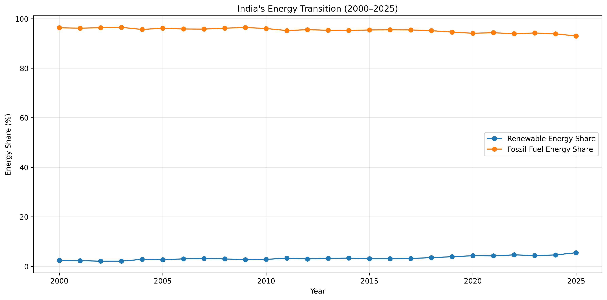
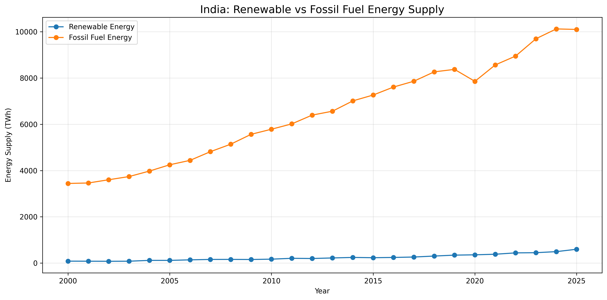
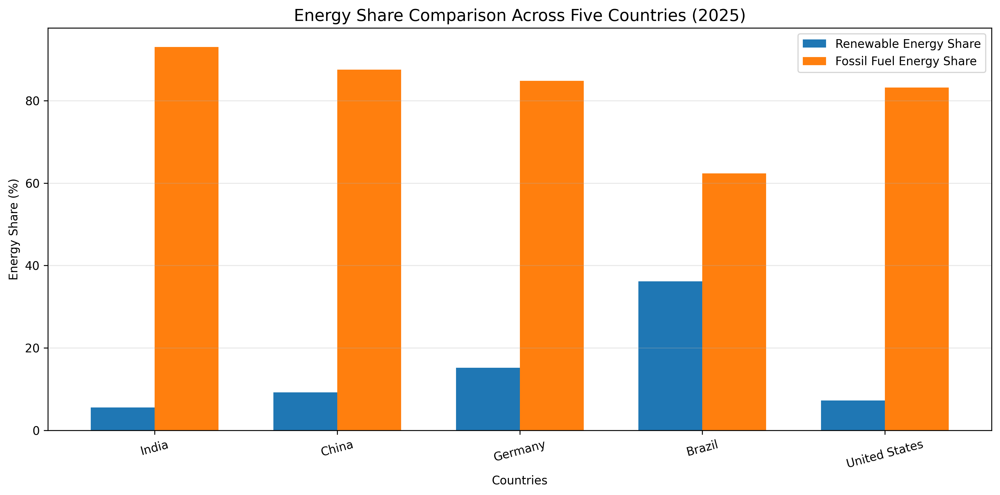
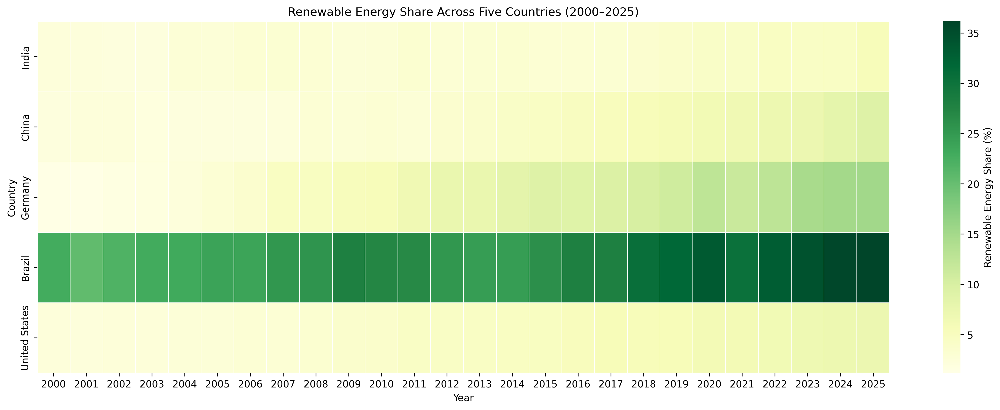
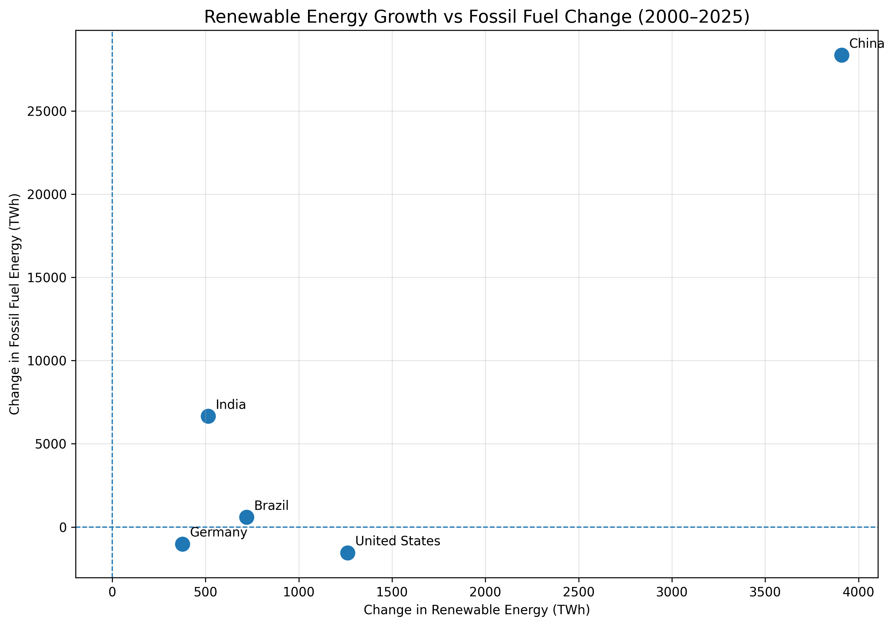

# 🌍 GREEN MIRAGE
## Is the World Really Going Green?

**A Data-Driven Investigation into Renewable Energy Growth and Fossil Fuel Dependence**


---

## 📌 Project Overview

Green Mirage is a Data Science mini-project investigating whether the growing adoption of renewable energy is accompanied by a reduction in fossil-fuel energy consumption.

While renewable energy adoption continues to receive global attention, an important question remains:

**Are countries actually reducing their dependence on fossil fuels, or are renewable energy sources simply expanding alongside them?**

This project uses publicly available energy data to investigate this question through exploratory data analysis, statistical comparisons and visualizations.

## 🎯 Research Objectives

- Analyze renewable energy growth over time.
- Examine fossil-fuel energy consumption patterns.
- Compare energy transitions across five selected countries.
- Investigate changes in absolute energy quantities and percentage shares.
- Identify patterns and relationships between renewable energy growth and fossil-fuel consumption.

## 🌍 Countries Studied

The project focuses on five countries:

1. 🇮🇳 India
2. 🇨🇳 China
3. 🇩🇪 Germany
4. 🇧🇷 Brazil
5. 🇺🇸 United States

**Analysis period:** 2000–2025, subject to indicator availability.

## 📊 Dataset Source

The project uses the Global Energy Dataset published by **Our World in Data (OWID)**.

- [Official Energy Dataset](https://catalog.ourworldindata.org/energy/owid_energy/)
- [CSV Dataset](https://catalog.ourworldindata.org/energy/owid_energy/owid_energy.csv)

Important indicators include:

- Total energy supply
- Renewable energy supply
- Fossil-fuel energy supply
- Renewable energy share
- Fossil-fuel energy share

Energy quantities are measured in terawatt-hours (TWh), while energy shares are expressed as percentages.

The analysis uses total energy supply indicators rather than electricity generation alone.

The original dataset is not redistributed in this repository. Please refer to the official source for the dataset and applicable licensing terms.

## 🛠️ Technologies Used

- Python
- Pandas
- NumPy
- Matplotlib
- Seaborn
- Google Colab
- GitHub

## 🔬 Project Workflow

1. Dataset collection and exploration
2. Selection of relevant energy indicators
3. Country and year filtering
4. Data quality checks and cleaning
5. Exploratory data analysis
6. Energy quantity and percentage comparisons
7. Data visualization
8. Research findings and conclusion

## 📈 Data Visualizations

### 1. India's Energy Transition

Examines changes in renewable and fossil-fuel energy shares over time.



### 2. The Energy Reality Check

Compares actual renewable and fossil-fuel energy quantities in TWh.



### 3. The Global Green Race

Compares renewable and fossil-fuel energy shares across the five selected countries for a common year.



### 4. Renewable Energy Growth Heatmap

Visualizes renewable energy shares across countries and years.



### 5. The Replacement Test

Explores the relationship between changes in renewable energy quantities and changes in fossil-fuel energy quantities.



## 📂 Repository Structure

```text
green-mirage-energy-analysis/
│
├── notebooks/
│   └── Green_Mirage_Energy_Analysis.ipynb
│
├── visualizations/
│   ├── 01_india_energy_transition.png
│   ├── 02_india_energy_quantities.png
│   ├── 03_global_energy_comparison.png
│   ├── 04_renewable_energy_heatmap.png
│   └── 05_energy_replacement_test.png
│
├── results/
│   ├── final_country_comparison.csv
│   ├── renewable_energy_ranking.csv
│   ├── india_energy_trends.csv
│   ├── energy_transition_patterns.csv
│   ├── country_data_coverage.csv
│   ├── indicator_data_coverage.csv
│   ├── missing_value_report.csv
│   ├── research_findings.txt
│   └── project_conclusion.txt
│
├── README.md
└── requirements.txt
```

## ⚙️ How to Run the Project

1. Clone or download this repository.
2. Open the notebook using Google Colab or Jupyter Notebook.
3. Install the required Python libraries:

```bash
pip install -r requirements.txt
```

4. Run the notebook cells sequentially.
5. The notebook retrieves the energy dataset from the official OWID source and performs the analysis.

An internet connection is required to retrieve the original dataset.

## ⚠️ Research Limitations

- The analysis covers five selected countries, not the entire world.
- Historical data availability varies by country and indicator.
- Energy quantities and energy shares represent different measurements.
- Endpoint comparisons do not capture every annual fluctuation.
- The observed relationships do not establish causation.
- Population growth, economic development and changing energy demand may influence energy consumption patterns.

## 💡 Project Significance

Green Mirage demonstrates how Data Science can be applied to investigate real-world sustainability questions.

By examining both energy quantities and percentage shares, the project aims to provide a more complete understanding of renewable energy expansion and fossil-fuel dependence.

## 👩‍💻 Author

**Jaimie Sandra Sam**

Integrated M.Tech – Computer Science and Engineering (Data Science)

Vellore Institute of Technology, Vellore

---

*Green Mirage — Looking beyond the green percentages.* 🌍
